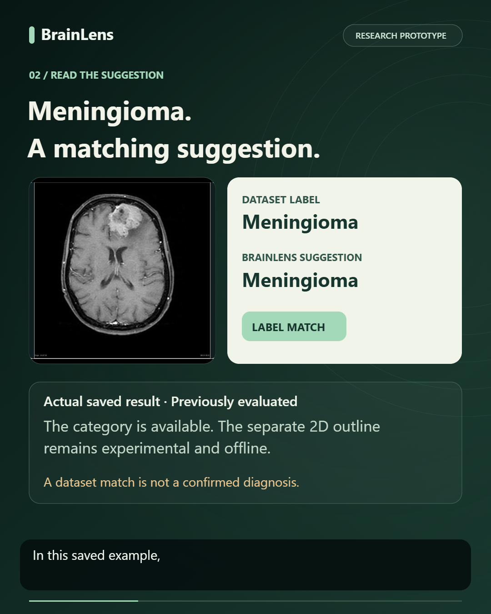

# BrainLens — research showcase

BrainLens is a local brain-MRI research website designed to make model outputs easier to inspect and understand.

[Watch or download the narrated demo](BrainLens-demo.mp4) · [Subtitle file](BrainLens-captions.srt) · [LinkedIn caption](LINKEDIN-POST.md)

## Current capabilities

- Suggested glioma, meningioma, pituitary or no-tumour dataset categories for supported 2D MRI slices.
- Axial, coronal and sagittal viewing of 3D MRI volumes.
- Candidate glioma-region overlays and volume measurements for compatible, prepared four-sequence scans.
- Editable research review summaries and saved-result review.

The demo reopens one previously evaluated MRI slice. BrainLens suggests **Meningioma**, matching its recorded dataset category. This example does not establish general accuracy or independent patient-level performance.

## Current limitations

BrainLens is a research prototype. Predictions are not confirmed diagnoses. A slice-level category does not diagnose a whole examination; a negative prediction does not establish a healthy brain. Examination-level tumour detection and broader abnormality assessment have not been independently validated. Experimental 2D tumour outlines remain offline following unsatisfactory evaluation.

The next milestone is independent evaluation using properly separated patient data. Feedback from medical-imaging researchers, radiologists and ML engineers is welcome.

## About this repository

This repository contains the public showcase materials, not the runnable application, model checkpoints, patient data or full research archive. The working local application and evidence are preserved separately. The video is approximately 65 seconds, 1080 × 1350, with synthetic ElevenLabs Mike narration slowed to 88% speed using pitch preservation and captions timed from the recording. No claim of real-human narration or clinician endorsement is made.

See [credits and reuse conditions](CREDITS.md) and [technical verification](VERIFICATION.json). No software licence is granted to the separate BrainLens application by this showcase repository.
